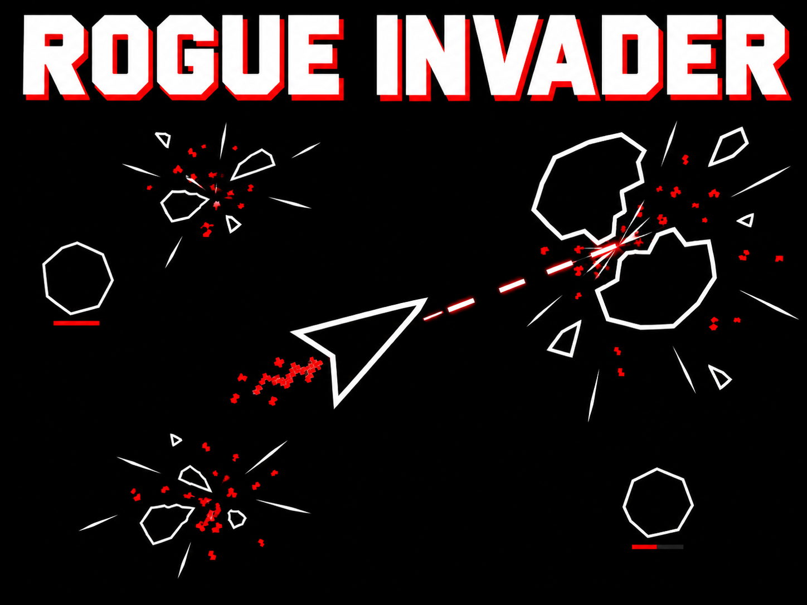

# ROGUE INVADER
**Version 0.15**

### [PLAY](https://rogueinvader.netlify.app)
## Quick FAQ

Q: Did you use AI in this project?  
A: Yes, I have been using ai to assist me in my game development journey and in no way is the AI making up ideas. This all comes from my head.

## Get involved

Want to help me work on this? Check out my [portfolio](https://kevincrafts.dev) and contact me.

Have any suggestions? Open a new [issue](https://github.com/Jarmahent/RogueInvader/issues/new) and I'll see if I can add it into my roadmap.

## Roadmap

### What is implemented

- [x] Add a pause screen
- [x] Add a resizable window
- [x] Implement the gold system
- [x] Implement the gold system and labels
- [x] Implement thruster animation when the ship moves forward
- [x] Add basic health and movement for the ship and enemies
- [x] Add the dashing mechanic
- [x] Add shooting mechanics

### What is not implemented

#### In Progress

- [ ] Figure out how modifiers will be acquired

#### To-Do

- [ ] Figure out level progression
- [ ] Implement a marketplace for purchasing upgrades
- [ ] Implement a stamina mechanic for dashing
- [ ] Implement a main menu
- [ ] Implement different powerups
